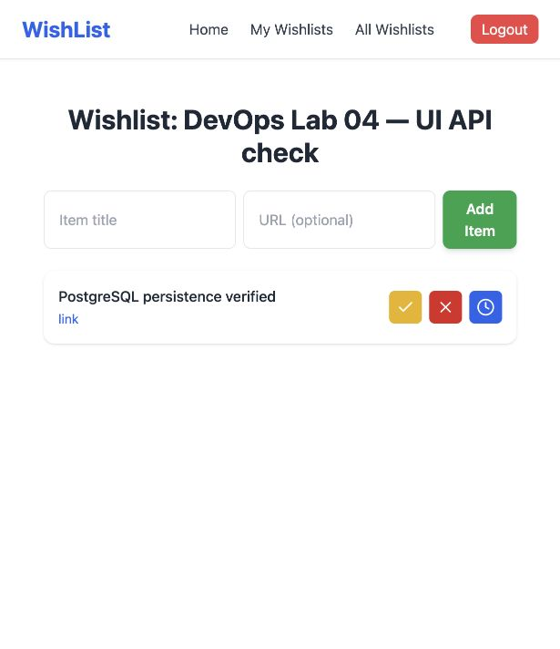

# Лабораторна №4 — завдання №1–3

Поточний обсяг: командні форки, локальна взаємодія Vue → FastAPI → PostgreSQL/Redis та конвеєри CI для API й UI (завдання №2–3). Завдання №4–5, rulesets і бонуси не виконуються.

## Команда

- Власник: [KushOleks](https://github.com/KushOleks).
- Другий учасник: [Porchuk](https://github.com/Porchuk). Запрошення прийнято через акаунт Porchuk; рівень Write в обох форках підтверджено GitHub API.
- Третій студент зможе приєднатися через Settings → Collaborators → Add people в обох форках з рівнем Write.

Репозиторії: [API](https://github.com/KushOleks/withlist-api), [UI](https://github.com/KushOleks/wishlist-ui). Upstream: [API](https://github.com/nromanen/withlist-api), [UI](https://github.com/nromanen/wishlist-ui).

## Передумови

Mac Apple Silicon (arm64), Git, Docker Desktop із запущеним Engine, Docker Compose, Node.js 24, npm. API працює у контейнері Python 3.11; системний Python 3.13 не використовується через старі зафіксовані залежності.

## Запуск

Налаштування завдання №1 збережено в гілках `lab-04/local-setup` обох форків.

```bash
git clone --branch lab-04/local-setup https://github.com/KushOleks/withlist-api.git
git clone --branch lab-04/local-setup https://github.com/KushOleks/wishlist-ui.git
cd withlist-api
cp .env.example .env
openssl rand -hex 32
```

Скопіювати отримане випадкове значення у SECRET_KEY в `.env`. Файл `.env` не комітити. Для локального PostgreSQL задано DB_SSLMODE=disable; стандартне значення в коді залишається require. Дані wishlist/wishlist_local призначені лише для цієї локальної БД. Порти контейнерів доступні лише через 127.0.0.1. PostgreSQL: localhost:15432, Redis: localhost:16379 (стандартні порти на Mac зайняті). Всередині мережі Compose API підключається до postgres:5432 та redis:6379.

```bash
docker compose -f compose.local.yml up -d --build
docker compose -f compose.local.yml ps
docker compose -f compose.local.yml logs --tail=100 api
curl http://localhost:8000/health
```

В іншому терміналі:

```bash
cd wishlist-ui
cp .env.example .env
npm ci
npm run dev -- --host 127.0.0.1
```

Node.js має бути версії 24 (перевірити `node --version`). UI: http://localhost:5173, API: http://localhost:8000, Swagger: http://localhost:8000/docs. У UI задано VITE_API_BASE=http://localhost:8000. Після зміни `.env` перезапустити Vite.

## Перевірка взаємодії

1. Зареєструвати тестового користувача через UI та увійти.
2. Створити список з унікальною назвою, додати побажання.
3. Оновити сторінку й переконатися, що дані збережено.
4. У Network браузера перевірити запити на localhost:8000 та успішні відповіді API.
5. Перевірити той самий список через GET /wishlists у Swagger.
6. Перевірити PostgreSQL і Redis:

```bash
docker compose -f compose.local.yml exec postgres psql -U wishlist -d wishlist -c 'SELECT id, title FROM wishlists;'
docker compose -f compose.local.yml exec redis redis-cli ping
```

Ці кроки повторює другий студент на своєму комп’ютері після прийняття запрошень. Його локальний запуск не вважається підтвердженим запуском на машині власника.

## Зупинка

Зупинити Vite через Ctrl+C. У папці API:

```bash
docker compose -f compose.local.yml down
```

Том PostgreSQL зберігає дані між запусками. Не додавати `-v`, якщо дані потрібні.

## Стан перевірки — 4 листопада 2026

- Наявність обох командних форків і правильний upstream підтверджено.
- Porchuk прийняв обидва запрошення; фактичний рівень write підтверджено.
- Vue відкривається в браузері; збірка UI успішна.
- API зібрано й запущено на Linux aarch64, Python 3.11. Локальні налаштування перевірено запуском.
- Docker Engine 29.2.0 відновлено після звільнення місця та перезапуску. PostgreSQL і Redis healthy; GET /health повертає status=healthy, redis=healthy. Через браузер успішно виконано реєстрацію, вхід, створення списку (id=1) і побажання (id=1). Після оновлення сторінки дані збереглися. SQL-запит підтвердив записи у wishlists/wish_items; API повернув ті самі назви. Redis повернув PONG і ключі all_wishlists, user_1_wishlists, wishlist_items_1.
- Локальний запуск на Mac власника та інтеграцію перевірено. Запуск на іншому комп’ютері ще не підтверджено. Жодних CI чи rulesets не налаштовано.

## Мінімальні виправлення для запуску

- API враховує DATABASE_URL; за відсутності використовує DB_* і DB_SSLMODE. Значення SSL за замовчуванням require, локально disable.
- Прибрано SSL-параметр з Redis-клієнта для звичайного redis://; rediss:// використовує стандартну перевірку сертифіката.
- У приклад середовища додано ALGORITHM=HS256 і правильні адреси сервісів. Реальний SECRET_KEY зберігається лише в ігнорованому .env.
- compose.local.yml запускає лише потрібні цьому етапу API, PostgreSQL і Redis з очікуванням готовності залежностей.
- У UI додано .env.example з VITE_API_BASE.

У журналі реєстрації passlib 1.7.4 показує попередження про атрибут версії bcrypt 4.3.0; реєстрація та вхід пройшли з HTTP 200. Залежності в межах цього етапу не оновлювалися.



## Завдання №2 — API CI (10 листопада 2026)

Підготовлено гілку `lab-04/api-ci` у форку API. Вона включає попередню гілку локального запуску.

- `.github/workflows/ci.yml`: pull_request та push у main, Ubuntu 24.04, Python 3.11.9; actions закріплені commit SHA.
- **API lint (Ruff)** виконується перед **API tests (PostgreSQL + Redis)**.
- Залежності зафіксовані з транзитивними пакетами та SHA256-хешами; pip кешується через setup-python.
- PostgreSQL і Redis працюють як тимчасові job services з health checks; перед pytest перевіряються SELECT 1 і PING.
- Два health-сценарії не звертаються до бази. Інтеграційний тест читає через endpoint список, створений у реальній тестовій PostgreSQL-транзакції. Дані тесту відкочуються.
- Додаткова негативна перевірка вимагає, щоб цей тест падав без PostgreSQL.

Локально Ruff і health-тести пройшли. Негативна перевірка підтвердила Connection refused. Онлайн [API CI успішний](https://github.com/KushOleks/withlist-api/actions/runs/42894806678): Ruff, 3 pytest-сценарії, SELECT 1/PING і перевірка провалу тесту без PostgreSQL.

[Pull Request API №1](https://github.com/KushOleks/withlist-api/pull/1) містить workflow, lockfile, тести та мінімальні зміни для їх запуску. [Пояснення API CI](https://github.com/KushOleks/withlist-api/blob/lab-04/api-ci/docs/checks.md). API PR №1 злитий у main; [CI після злиття успішний](https://github.com/KushOleks/withlist-api/actions/runs/42909473907).

API PR №1 має схвалення з акаунта Porchuk. Запуск застосунку на його комп'ютері залишається окремим кроком.

## Завдання №3 — UI CI (11 листопада 2026)

Гілка `lab-04/ui-ci` у форку wishlist-ui містить три послідовні перевірки:

1. **UI lint (ESLint)** — npm run lint. Додано конфігурацію Vue/TypeScript, виправлено явні any та невикористані catch-змінні.
2. **UI types (vue-tsc)** — npm run typecheck.
3. **UI build (Vite)** — npm run build і завантаження dist як артефакту wishlist-ui-dist на 14 днів.

Workflow запускається на pull_request та push у main. Ubuntu 24.04, Node.js 24.21.0 і версії Actions закріплено; встановлення виконується через npm ci, кеш npm залежить від package-lock.json. Локально чисте npm ci та всі три команди пройшли. Тести UI не додаються відповідно до умови.

[UI PR №1](https://github.com/KushOleks/wishlist-ui/pull/1) і [успішний UI CI](https://github.com/KushOleks/wishlist-ui/actions/runs/42913704389): усі три перевірки пройшли. Артефакт wishlist-ui-dist завантажено та перевірено: index.html, JavaScript і CSS присутні. [Пояснення UI CI](https://github.com/KushOleks/wishlist-ui/blob/lab-04/ui-ci/docs/checks.md). Захист гілок, демонстрація блокування merge та вимірювання часу кешу залишаються на завдання №4–5.
