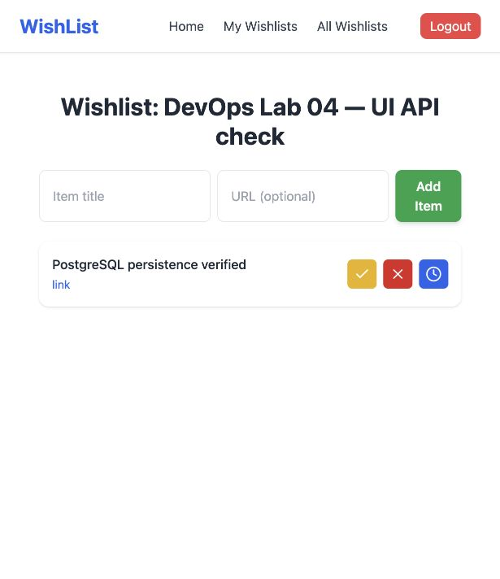

# Лабораторна №4 — завдання №1–5

Поточний обсяг: локальний запуск, API/UI CI, обов’язкові перевірки main та вимірювання ефекту кешу (завдання №1–5). Бонусні завдання та їх перевірки описані нижче. Локальний запуск підтверджений на Mac власника; кожному іншому учаснику ще потрібно окремо підтвердити свій запуск.

## Команда

- Власник: [KushOleks](https://github.com/KushOleks).
- Другий учасник: [Porchuk](https://github.com/Porchuk). Запрошення прийнято через акаунт Porchuk; рівень Write в обох форках підтверджено GitHub API.
- Третій учасник: [ookioy](https://github.com/ookioy). Запрошення до обох форків прийняті 15 листопада 2026; Write-доступ підтверджено.

Репозиторії: [API](https://github.com/KushOleks/withlist-api), [UI](https://github.com/KushOleks/wishlist-ui). Upstream: [API](https://github.com/nromanen/withlist-api), [UI](https://github.com/nromanen/wishlist-ui).

## Передумови

Mac Apple Silicon (arm64), Git, Docker Desktop із запущеним Engine, Docker Compose, Node.js 24, npm. API працює у контейнері Python 3.11; системний Python 3.13 не використовується через старі зафіксовані залежності.

## Запуск

Налаштування локального запуску й конвеєри злиті в main обох форків. Для запуску використовуйте main.

```bash
git clone --branch main https://github.com/KushOleks/withlist-api.git
git clone --branch main https://github.com/KushOleks/wishlist-ui.git
cd withlist-api
cp .env.example .env
openssl rand -hex 32
```

Скопіювати отримане випадкове значення у SECRET_KEY в `.env`. Файл `.env` не комітити. Для локального PostgreSQL задано DB_SSLMODE=disable; стандартне значення в коді залишається require. Дані wishlist/wishlist_local призначені лише для цієї локальної БД. Порти контейнерів доступні лише через 127.0.0.1. PostgreSQL: localhost:15432, Redis: localhost:16379 (стандартні порти на Mac зайняті). Всередині мережі Compose API підключається до postgres:5432 та redis:6379.

```bash
docker compose -f compose.local.yml up -d --build
docker compose -f compose.local.yml ps
docker compose -f compose.local.yml logs --tail=100 api
curl http://localhost:8000/health
```

В іншому терміналі:

```bash
cd wishlist-ui
cp .env.example .env
npm ci
npm run dev -- --host 127.0.0.1
```

Node.js має бути версії 24 (перевірити `node --version`). UI: http://localhost:5173, API: http://localhost:8000, Swagger: http://localhost:8000/docs. У UI задано VITE_API_BASE=http://localhost:8000. Після зміни `.env` перезапустити Vite.

## Перевірка взаємодії

1. Зареєструвати тестового користувача через UI та увійти.
2. Створити список з унікальною назвою, додати побажання.
3. Оновити сторінку й переконатися, що дані збережено.
4. У Network браузера перевірити запити на localhost:8000 та успішні відповіді API.
5. Перевірити той самий список через GET /wishlists у Swagger.
6. Перевірити PostgreSQL і Redis:

```bash
docker compose -f compose.local.yml exec postgres psql -U wishlist -d wishlist -c 'SELECT id, title FROM wishlists;'
docker compose -f compose.local.yml exec redis redis-cli ping
```

Ці кроки повторює другий студент на своєму комп’ютері після прийняття запрошень. Його локальний запуск не вважається підтвердженим запуском на машині власника.

## Зупинка

Зупинити Vite через Ctrl+C. У папці API:

```bash
docker compose -f compose.local.yml down
```

Том PostgreSQL зберігає дані між запусками. Не додавати `-v`, якщо дані потрібні.

## Стан перевірки — 4 листопада 2026

- Наявність обох командних форків і правильний upstream підтверджено.
- Porchuk прийняв обидва запрошення; фактичний рівень write підтверджено.
- Vue відкривається в браузері; збірка UI успішна.
- API зібрано й запущено на Linux aarch64, Python 3.11. Локальні налаштування перевірено запуском.
- Docker Engine 29.2.0 відновлено після звільнення місця та перезапуску. PostgreSQL і Redis healthy; GET /health повертає status=healthy, redis=healthy. Через браузер успішно виконано реєстрацію, вхід, створення списку (id=1) і побажання (id=1). Після оновлення сторінки дані збереглися. SQL-запит підтвердив записи у wishlists/wish_items; API повернув ті самі назви. Redis повернув PONG і ключі all_wishlists, user_1_wishlists, wishlist_items_1.
- Локальний запуск на Mac власника та інтеграцію перевірено. Запуск на іншому комп’ютері ще не підтверджено. Жодних CI чи rulesets не налаштовано.

## Мінімальні виправлення для запуску

- API враховує DATABASE_URL; за відсутності використовує DB_* і DB_SSLMODE. Значення SSL за замовчуванням require, локально disable.
- Прибрано SSL-параметр з Redis-клієнта для звичайного redis://; rediss:// використовує стандартну перевірку сертифіката.
- У приклад середовища додано ALGORITHM=HS256 і правильні адреси сервісів. Реальний SECRET_KEY зберігається лише в ігнорованому .env.
- compose.local.yml запускає лише потрібні цьому етапу API, PostgreSQL і Redis з очікуванням готовності залежностей.
- У UI додано .env.example з VITE_API_BASE.

У журналі реєстрації passlib 1.7.4 показує попередження про атрибут версії bcrypt 4.3.0; реєстрація та вхід пройшли з HTTP 200. Залежності в межах цього етапу не оновлювалися.



## Завдання №2 — API CI (10 листопада 2026)

Підготовлено гілку `lab-04/api-ci` у форку API. Вона включає попередню гілку локального запуску.

- `.github/workflows/ci.yml`: pull_request та push у main, Ubuntu 24.04, Python 3.11.9; actions закріплені commit SHA.
- **API lint (Ruff)** виконується перед **API tests (PostgreSQL + Redis)**.
- Залежності зафіксовані з транзитивними пакетами та SHA256-хешами; pip кешується через setup-python.
- PostgreSQL і Redis працюють як тимчасові job services з health checks; перед pytest перевіряються SELECT 1 і PING.
- Два health-сценарії не звертаються до бази. Інтеграційний тест читає через endpoint список, створений у реальній тестовій PostgreSQL-транзакції. Дані тесту відкочуються.
- Додаткова негативна перевірка вимагає, щоб цей тест падав без PostgreSQL.

Локально Ruff і health-тести пройшли. Негативна перевірка підтвердила Connection refused. Онлайн [API CI успішний](https://github.com/KushOleks/withlist-api/actions/runs/42894806678): Ruff, 3 pytest-сценарії, SELECT 1/PING і перевірка провалу тесту без PostgreSQL.

[Pull Request API №1](https://github.com/KushOleks/withlist-api/pull/1) містить workflow, lockfile, тести та мінімальні зміни для їх запуску. [Пояснення API CI](https://github.com/KushOleks/withlist-api/blob/main/docs/checks.md). API PR №1 злитий у main; [CI після злиття успішний](https://github.com/KushOleks/withlist-api/actions/runs/42909473907).

API PR №1 має схвалення з акаунта Porchuk. Запуск застосунку на його комп'ютері залишається окремим кроком.

## Завдання №3 — UI CI (11 листопада 2026)

Гілка `lab-04/ui-ci` у форку wishlist-ui містить три послідовні перевірки:

1. **UI lint (ESLint)** — npm run lint. Додано конфігурацію Vue/TypeScript, виправлено явні any та невикористані catch-змінні.
2. **UI types (vue-tsc)** — npm run typecheck.
3. **UI build (Vite)** — npm run build і завантаження dist як артефакту wishlist-ui-dist на 14 днів.

Workflow запускається на pull_request та push у main. Ubuntu 24.04, Node.js 24.21.0 і версії Actions закріплено; встановлення виконується через npm ci, кеш npm залежить від package-lock.json. Локально чисте npm ci та всі три команди пройшли. Тести UI не додаються відповідно до умови.

[UI PR №1](https://github.com/KushOleks/wishlist-ui/pull/1) і [успішний UI CI](https://github.com/KushOleks/wishlist-ui/actions/runs/42913704389): усі три перевірки пройшли. Артефакт wishlist-ui-dist завантажено та перевірено: index.html, JavaScript і CSS присутні. [Пояснення UI CI](https://github.com/KushOleks/wishlist-ui/blob/main/docs/checks.md). Захист гілок, демонстрація блокування merge та вимірювання кешу описані нижче.

## Уточнення конфігурації PostgreSQL

У [API PR №2](https://github.com/KushOleks/withlist-api/pull/2) прибрано дубль TEST_DATABASE_URL. Застосунок, перевірка готовності та інтеграційний тест використовують одну DATABASE_URL. REDIS_URL залишилася для Redis. Тест перевіряє, що назва PostgreSQL-бази закінчується на _test. PR схвалено з акаунта ookioy після успішного CI та злито в main.

## Завдання №4 — rulesets і демонстрація блокування

- [API ruleset](https://github.com/KushOleks/withlist-api/rules/27323838).
- [UI ruleset](https://github.com/KushOleks/wishlist-ui/rules/27323839).

В обох форках main вимагає PR, одне схвалення, усі required CI checks і актуальність гілки. Нові коміти скидають застарілі схвалення. Force-push і видалення main заборонено; bypass_actors порожній, включно для адміністратора.

[API PR №3](https://github.com/KushOleks/withlist-api/pull/3) та [UI PR №2](https://github.com/KushOleks/wishlist-ui/pull/2) демонструють червоний CI, конкретну помилку й виправлення в тому самому PR. Рівно по три справжні скриншоти з поясненнями зберігаються в docs/checks.md та docs/assets кожного форка:

- [API: докази](https://github.com/KushOleks/withlist-api/blob/main/docs/checks.md).
- [UI: докази](https://github.com/KushOleks/wishlist-ui/blob/main/docs/checks.md).

## Завдання №5 — ефект кешу

| Репозиторій | Холодний старт | Наступний прогін | Різниця |
|---|---:|---:|---:|
| API | 110 с | 81 с | 29 с (26,4%) |
| UI | 57 с | 53 с | 4 с (7,0%) |

Джерело — run_duration_ms GitHub Actions API; посилання й найдовші кроки наведені в docs/checks.md форків. Журнали підтверджують cache miss у першому lint та cache hit у наступному прогоні з тим самим lockfile. Подальші job першого прогону вже могли отримати кеш — це холодний старт workflow, а не вимкнений кеш у кожному job.

## Поточна командна історія

- KushOleks: власник форків, commits/PR локального запуску, обох конвеєрів та доказів.
- Porchuk: схвалення API PR №1; схвалення виправленого API PR №3 із доказами.
- ookioy: прийнятий доступ до обох форків, схвалення API PR №2; схвалення виправленого UI PR №2 із доказами.

Це опис дій акаунтів у GitHub. Окремий локальний запуск на комп’ютерах Porchuk і ookioy не підтверджено; не слід представляти запуск на Mac власника як три незалежні запуски.

## Фінальна перевірка основної частини

API PR №3 та UI PR №2 злиті після зеленого CI та повторного review фінальних комітів. Автоматичне скидання попередніх схвалень після нових комітів перевірено фактично: обидва PR отримали REVIEW_REQUIRED, попередні reviews — DISMISSED.

- [Фінальний API CI на main](https://github.com/KushOleks/withlist-api/actions/runs/43746696177).
- [Фінальний UI CI на main](https://github.com/KushOleks/wishlist-ui/actions/runs/43746700839).

Локальна папка проєктів: `/Users/mac/Documents/DevOps/lab-04`. Усі актуальні зміни доступні в main. Перевірки й дані захисту гілок стосуються обох командних форків; персональне портфоліо містить звіт. Бонусні завдання та їх перевірки описані нижче.


## Бонусні завдання (15 листопада 2026)

### 1. Матриця Python

[API PR №4](https://github.com/KushOleks/withlist-api/pull/4) додає Python 3.11.9
і 3.12.12 з `fail-fast: false`. Обидва варіанти виконують реальні перевірки
PostgreSQL і Redis та три тестові сценарії. psycopg2-binary оновлено до 2.9.10
для підтримки Python 3.12; lock-файл з хешами оновлено.

[Зелений фінальний прогін PR](https://github.com/KushOleks/withlist-api/actions/runs/43757100176).
[CI після злиття в main](https://github.com/KushOleks/withlist-api/actions/runs/43757334988).
API ruleset тепер вимагає три перевірки: `API lint (Ruff)`,
`API tests (Python 3.11.9)` і `API tests (Python 3.12.12)`.
Інші обмеження збережені: одне схвалення, актуальна гілка, скидання застарілих
reviews, заборона force-push/видалення та відсутність bypass.

### 2. Нічні аудити залежностей

| Репозиторій | PR та автор акаунта | Розклад UTC | Звіт |
|---|---|---|---|
| API | [№5 — Porchuk](https://github.com/KushOleks/withlist-api/pull/5) | щодня 01:17 | api-dependency-audit / pip-audit.json |
| UI | [№3 — ookioy](https://github.com/KushOleks/wishlist-ui/pull/3) | щодня 01:37 | ui-dependency-audit / npm-audit.json |

Обидва `.github/workflows/dependency-audit.yml` мають тільки `schedule` та
`workflow_dispatch`, без події pull_request. Вони не входять до required checks.
Час розкладу задано UTC; фактичний старт може затриматися у черзі GitHub Actions.
Перший аудит перевірено ручним запуском, нічного автоматичного запуску ще не спостерігали.
Звіти зберігаються через `if: always()` на 14 днів.

Результати контрольних запусків:
- [API, перший запуск](https://github.com/KushOleks/withlist-api/actions/runs/43757037989):
  46 записів про відомі вразливості у 13 пакетах. Перевірявся lock-файл до додавання pytest-cov.
- [API, остаточний lock-файл](https://github.com/KushOleks/withlist-api/actions/runs/43757356882):
  перевірено 45 залежностей, 46 записів про вразливості у 13 пакетах.
- [UI](https://github.com/KushOleks/wishlist-ui/actions/runs/43757235478):
  18 проблем (14 high, 4 moderate), без технічної помилки npm audit.

Червоний аудит повідомляє про вразливості, а не приховує їх через continue-on-error.
Звіти доступні навіть при статусі failure. Автоматичне виправлення залежностей
не застосовувалося: сумісність оновлень потребує окремої перевірки.

### 3. Покриття API та артефакт після падіння

pytest-cov створює XML (`coverage.xml`) і HTML (`htmlcov/`). Артефакти окремі
для кожної версії: `api-coverage-python-3.11.9` і `api-coverage-python-3.12.12`.
Upload має `if: always()` і стоїть до негативної перевірки недоступної БД.

[Контрольний червоний прогін](https://github.com/KushOleks/withlist-api/actions/runs/43756512715)
містив тимчасовий тест з AssertionError: обидва jobs завершилися з `1 failed, 3 passed`,
але обидва артефакти збережено. Тест видалено в наступному коміті того самого PR.
[Остаточний зелений прогін](https://github.com/KushOleks/withlist-api/actions/runs/43757100176)
також містить обидва звіти: **228 із 414 рядків, 55,07% покриття рядків**.
Поріг покриття не встановлювався; інші маршрути потребують додаткових тестів.
Якщо помилка виникла до запуску pytest, звіт ще не буде створений.

### Розподіл дій акаунтів у бонусах

- **KushOleks:** PR матриці та покриття, оновлення назв required checks,
  перевірка і схвалення PR аудитів, злиття PR, контрольні запуски та звіт.
- **Porchuk:** commit і PR нічного API-аудиту; review та Approve фінального PR матриці/покриття.
- **ookioy:** commit і PR нічного UI-аудиту; review підсумкового звіту портфоліо.

PR аудитів злиті після зеленого обов’язкового CI. PR матриці злитий після
трьох зелених перевірок і схвалення Porchuk. Це історія GitHub-акаунтів;
індивідуальний локальний запуск інших учасників не підтверджено.

### Як показати бонуси на захисті

1. У VS Code відкрити withlist-api → `.github/workflows/ci.yml`:
   показати matrix, дві версії й fail-fast: false. В Actions відкрити зелений
   прогін: обидва Python jobs успішні. У ruleset показати обидві назви required checks.
2. У цьому самому workflow показати команду pytest з --cov і upload з always().
   Відкрити червоний контрольний прогін, пояснити тимчасову помилку тесту й показати
   обидва артефакти. Потім відкрити зелений прогін, завантажити ZIP,
   розпакувати і відкрити HTML index.html. Пояснити реальні 55,07%, без заяви про повне покриття.
3. У кожному форку відкрити dependency-audit.yml: показати cron, ручний запуск,
   команду аудиту та always() для JSON. В Actions показати результати й артефакти.
   Пояснити: «Аудити виявили проблеми старих залежностей. Вони повідомляють про стан main,
   але не блокують PR; виправлення версій перевіряються окремо».
4. Відкрити PR API №5, UI №3 і API №4: показати авторів, схвалення іншими акаунтами
   та факт merge. Porchuk пояснює API-аудит і матрицю, ookioy — UI-аудит і звіт,
   KushOleks — інтеграцію змін та правила main.

[Детальніша інструкція бонусів API](https://github.com/KushOleks/withlist-api/blob/main/docs/bonuses.md).
Артефакти мають обмежений строк зберігання; для пізнішого захисту слід повторно
запустити workflow або заздалегідь завантажити звіти.
